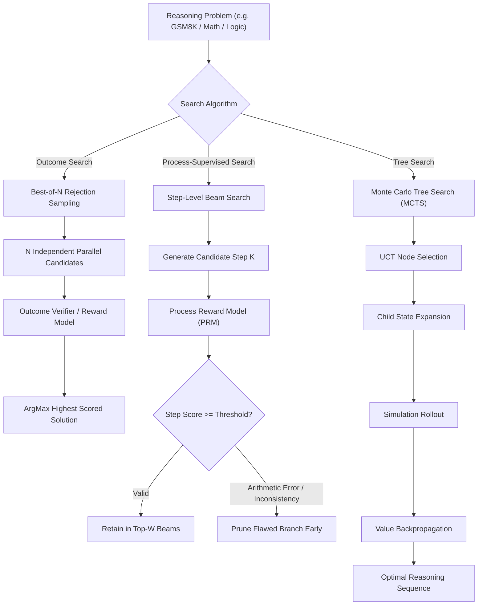

# Verifier-Guided Search & Test-Time Compute 🔍

A high-performance algorithmic reasoning repository demonstrating test-time compute scaling, rejection sampling, and tree search, built with Python.
This repository serves as **Foundation 4** of our AI engineering portfolio, demonstrating how test-time search and step-level process reward models (PRMs) achieve state-of-the-art accuracy over single-pass generation.

---

## 🏛️ System Architecture



---

## 🚀 Milestones & Implementation Progress

### Milestone 1: Best-of-N Rejection Sampling (Completed ✅)
* **Functional Implementation**: Implemented in [`search/best_of_n.py`](search/best_of_n.py).
* **Parallel Hypothesis Testing**: Evaluates $N$ candidates against an objective verifier function to isolate the best candidate.

### Milestone 2: Process Reward Model (PRM) Step Verification (Completed ✅)
* **Step-Level Auditor**: Implemented in [`search/prm.py`](search/prm.py).
* **Early Error Pruning**: Validates equations, arithmetic proofs, and logical assertions at each intermediate step before errors cascade downstream.
* **Step Beam Search**: Combines PRM scoring with multi-beam exploration to find the highest-probability path.

### Milestone 3: Monte Carlo Tree Search (MCTS) (Completed ✅)
* **UCT Tree Policy**: Implemented in [`search/mcts.py`](search/mcts.py) with balance between exploitation (node value) and exploration ($\sqrt{\ln N / n}$).
* **Simulation & Backpropagation**: Propagates terminal rewards back up the search tree to update visit counts and Q-values.

### Milestone 4: Test-Time Compute Scaling Benchmark (Completed ✅)
* **Scaling Law Evaluation**: Implemented in [`search/scaling.py`](search/scaling.py).
* **Pass@N Curves**: Measures accuracy scaling empirically as sample budget $N$ grows from $N=1$ to $N=16$.

---

## 🧪 Comprehensive Automated Test Suite

```bash
python -m pytest tests/ -v
```

* **`tests/test_best_of_n.py`** (2 tests): Candidate ranking, empty candidate edge case.
* **`tests/test_advanced_search.py`** (6 tests): Negative candidate scores, UCT root metrics, deterministic integer state tree, scaling law monotonic growth and upper bounds.
* **`tests/test_mcts.py`** (1 test): Tree expansion, rollout, UCT selection.
* **`tests/test_prm.py`** (5 tests): Arithmetic verification, flawed step detection, trajectory scoring, error step indexing, step-level beam search.
* **`tests/test_advanced_prm.py`** (8 tests): Float arithmetic, negative number equations, parenthesized expressions, division-by-zero resilience, custom evaluators, greedy beam search width=1, empty trajectory handling.
* **`tests/test_scaling.py`** (1 test): Accuracy scaling across candidate budgets.

**Result**: `23 passed, 100% test success rate`.
